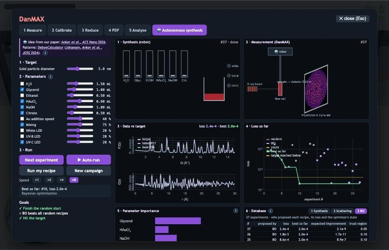

# MAX IV Explorer

An open-world 3D game set at the **MAX IV synchrotron** in Lund, Sweden. Walk or ride a kick scooter around the
528 m ring hall, the storage-ring tunnel, the linac, the office and the tram stop – and do real-looking X-ray
experiments at the **CoSAXS** and **DanMAX** beamlines: mount a sample, search the hutch, calibrate the detector,
reduce 2D images to 1D patterns and analyse them. A synthesis robot even runs a closed-loop, AI-driven experiment.

Made for teaching: students can make the classic mistakes (forgetting the beamstop, skipping the calibration,
ignoring the safety search) in the game instead of at the beamline.

## ▶ Play

**https://andysanker.github.io/maxiv-explorer/**

Runs in any modern desktop browser (Chrome, Edge, Firefox, Safari) – nothing to install. A computer with a mouse
and keyboard is best; the first load is about 7 MB.

Offline: download the repository (green **Code** button → *Download ZIP*), unzip and double-click `index.html`.

| Key | Action | Key | Action |
|---|---|---|---|
| **W A S D** | move | **E** | interact (doors, tables, beamlines, food truck …) |
| **Shift** | sprint | **F** | get on / off a kick scooter |
| **Mouse** | look (click the game first) | **M** | map |
| **Wheel / C** | camera distance | **H** / **Esc** | help, credits |
| **Space** | jump | **T** | chat (multiplayer only) |

**Getting started:** walk into the main entrance to the reception for your badge, then follow the yellow mission
markers. The help screen (**H**) explains everything else.

## What you can do

* **Two working beamlines.** CoSAXS (SAXS/WAXS, EIGER2 4M) and DanMAX (powder diffraction and PDF, PILATUS4 X CdTe 4M):
  measure, calibrate, reduce and analyse, with simulated detector images and money for good data and for accidents.
  A step-by-step guide with arrows leads you through the hutch search.
* **Autonomous synthesis.** A robot makes gold nanoparticles, the beamline measures them, and Bayesian optimisation
  picks the next recipe until the target pattern is reached – a game version of our ScatterLab paper.
* **Around the site.** All 3 GeV beamlines in their real order, the exhibition “From MAX I to MAX IV”, table tennis,
  golden photons to collect, courier missions, a food truck with a new menu every day, and photos of the real MAX IV.

More detail on every feature: **[docs/GAMEPLAY.md](docs/GAMEPLAY.md)**.



## Play together (multiplayer)

Players on the same server see each other and can chat (**T**). The GitHub Pages version above is single-player;
for multiplayer run the small included server (Node.js, no installation of packages needed):

```bash
node server/server.mjs
```

Then open `http://localhost:8080` – classmates on the same network use `http://<your-IP>:8080`. Add
`?room=yourclass` to the address to get a private room. To put it online for free (Render, Docker, …) see
**[HOSTING.md](HOSTING.md)**. The server stores nothing and filters names and chat.

## For teachers

* No accounts, no installation, no data collected. The player's name, saved calibrations and measured datasets
  stay in their own browser; on a multiplayer server only name, position and chat are shared, and nothing is stored.
* A class can share a room on your own multiplayer server: `https://your-server/?room=kemi2026`.
* The physics is simplified but honest: patterns are calculated with DebyeCalculator, detectors and beamline
  layouts follow the real instruments, and the in-game help says what is simulated.

## Develop

The game is plain JavaScript with [three.js](https://threejs.org) – no npm packages, no framework.

```bash
python3 -m http.server 8000        # then open http://localhost:8000/dev.html – edit js/*.js and reload
./build.sh                         # rebuild game.bundle.js (needs Python 3 + Pillow) before committing
```

Start with **[DEVELOPING.md](DEVELOPING.md)**: how the code is organised, how to add a building, an interaction,
a mission or a sample, and how the scattering data are generated.

## Credits and licence

* Code: [MIT licence](LICENSE) © 2026 Andy Sode Anker.
* 3D engine: [three.js](https://threejs.org) r160 (MIT), vendored in `vendor/`.
* Scattering patterns: [DebyeCalculator](https://github.com/FrederikLizakJohansen/DebyeCalculator) (Apache 2.0) –
  F. L. Johansen, A. S. Anker, U. Friis-Jensen, E. B. Dam, K. M. Ø. Jensen, R. Selvan, *J. Open Source Softw.* 2024,
  9(94), 6024, [doi:10.21105/joss.06024](https://doi.org/10.21105/joss.06024).
* Autonomous synthesis: A. S. Anker *et al.*, “Autonomous Synthesis of Nanoparticles with Target Scattering
  Patterns”, *ACS Nano* 2026, 20, 6767–6782, [doi:10.1021/acsnano.5c15488](https://doi.org/10.1021/acsnano.5c15488).
* Photos: Wikimedia Commons under Creative Commons licences – authors and licences in
  [assets/photos/credits.json](assets/photos/credits.json) and in the in-game help (**H**).
* X-ray form factors: International Tables for Crystallography Vol. C; detector data: DECTRIS data sheets and the
  MAX IV website. Example SAXS data in the analysis tab: *Angew. Chem. Int. Ed.* 2021, e202103641
  ([details](assets/example_data/README.md)) – measured elsewhere, not at CoSAXS.

*Fan-made game. Not affiliated with or endorsed by MAX IV Laboratory or Lund University. The site layout is a
playful, simplified version of the real one.*
